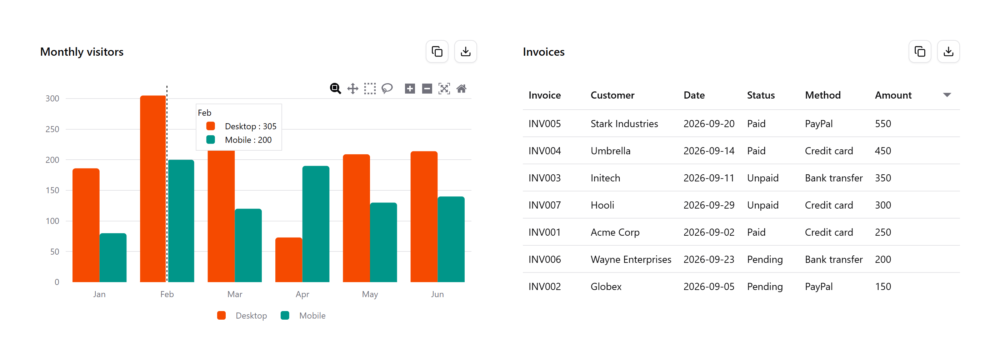

# Chartable

[](https://www.npmjs.com/package/@iamzices/chartable)
[](https://www.npmjs.com/package/@iamzices/chartable)
[](https://www.jsdelivr.com/package/npm/@iamzices/chartable)
[](https://github.com/iamzices/chartable/actions/workflows/ci.yml)
[](LICENSE)

Chartable is an easy to use interactive chart, table and diagram JavaScript library built on [Plotly.js](https://plotly.com/javascript/), [Tabulator](https://tabulator.info/) and [Mermaid](https://mermaid.js.org/).



## Features

- Interactive line, area, bar, scatter and pie charts
- Interactive tables
- Mermaid diagrams such as flowcharts and sequence diagrams, with zoom and pan
- Copy and download from the right-click menu, as CSV for data or as Mermaid code and SVG for diagrams

## Load as a node module

```sh
npm i @iamzices/chartable
```

```js
import { render } from "@iamzices/chartable";

render("sales", { kind: "bar", columns: ["month", "sales"], rows: [["Jan", 12], ["Feb", 9]] });
```

## Load via script tag

```html
<div id="visitors"></div>
<script src="https://cdn.jsdelivr.net/npm/@iamzices/chartable"></script>
<script>
  Chartable.render("visitors", {
    title: "Monthly visitors",
    kind: "line",
    columns: ["month", "Desktop", "Mobile"],
    rows: [
      ["Jan", 186, 80],
      ["Feb", 305, 200],
      ["Mar", 237, 120],
    ],
  });
</script>

<div id="signup"></div>
<script>
  Chartable.render("signup", {
    title: "Sign-up flow",
    kind: "mermaid",
    code: "flowchart LR; A[Visit] --> B{Signed up?}; B -- Yes --> C[Dashboard]; B -- No --> A",
  });
</script>
```

## API

### `render(container, spec)`

Resolves to a function that removes the card.

`spec` fields:

| Field     | Description                                                                  |
| --------- | ---------------------------------------------------------------------------- |
| `columns` | Column names.                                                                |
| `rows`    | Arrays of values in column order. Use `null` for an empty value.             |
| `code`    | Mermaid code for `"mermaid"`, used instead of `columns` and `rows`.          |
| `kind`    | `"line"`, `"area"`, `"bar"`, `"scatter"`, `"pie"`, `"table"` or `"mermaid"`. |
| `title`   | Heading.                                                                     |
