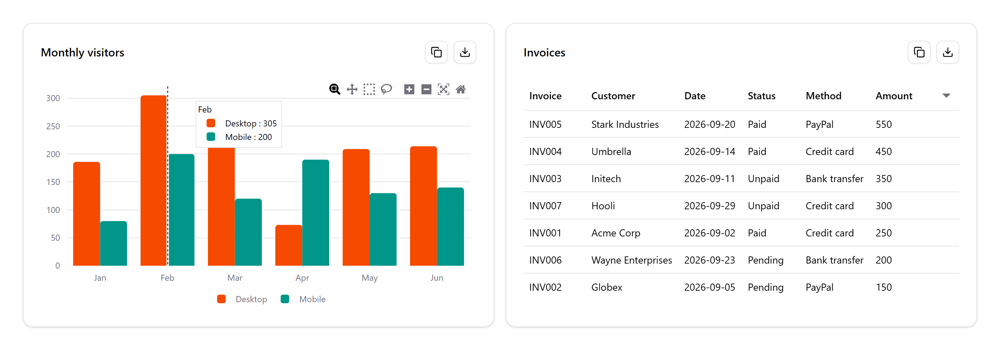

# Chartable

[](https://www.npmjs.com/package/@iamzices/chartable)
[](https://www.npmjs.com/package/@iamzices/chartable)
[](https://github.com/iamzices/chartable/actions/workflows/ci.yml)
[](LICENSE)

Chartable is an easy to use interactive chart and table JavaScript library built on [Plotly.js](https://plotly.com/javascript/) and [Tabulator](https://tabulator.info/).



## Features

- Interactive line, area, bar, scatter and pie charts
- Interactive tables
- CSV export and copy to clipboard

## Load as a node module

```sh
npm i @iamzices/chartable
```

```js
import { render } from "@iamzices/chartable";

render({ kind: "bar", columns: ["month", "sales"], rows: [["Jan", 12], ["Feb", 9]] });
```

## Load via script tag

```html
<script src="https://cdn.jsdelivr.net/npm/@iamzices/chartable@0.1.1"></script>
<script>
  Chartable.render({
    title: "Monthly visitors",
    kind: "line",
    columns: ["month", "Desktop", "Mobile"],
    rows: [
      ["Jan", 186, 80],
      ["Feb", 305, 200],
      ["Mar", 237, 120],
    ],
  });
</script>
```

## API

### `render(spec)`

| Field     | Description                                                      |
| --------- | ---------------------------------------------------------------- |
| `columns` | Column names.                                                    |
| `rows`    | Arrays of values in column order. Use `null` for an empty value. |
| `kind`    | `"line"`, `"area"`, `"bar"`, `"scatter"`, `"pie"` or `"table"`.  |
| `title`   | Heading.                                                         |